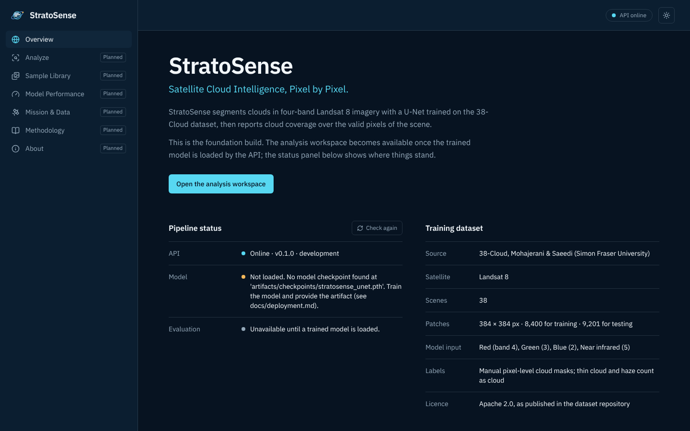

# StratoSense

**Satellite Cloud Intelligence, Pixel by Pixel.**

StratoSense segments clouds in four-band (Red, Green, Blue, Near-Infrared) Landsat 8 imagery with a U-Net trained on the
[38-Cloud](https://github.com/SorourMo/38-Cloud-A-Cloud-Segmentation-Dataset) dataset, and reports cloud coverage over the valid pixels of a scene.



## Project status

> **Foundation stage.** The model has **not** been trained and no predictions can be made yet. The app says so wherever it matters.

| Area | State |
|---|---|
| Repository structure, config, CI workflow, docs | Done |
| FastAPI app with `/api/v1/health` and `/api/v1/ready` (503 until a real model loads) | Done, tested |
| React shell: navigation, dark/light theme, live pipeline status | Done, tested, built |
| ML: name-based band matching, scene-level split, normalization, official scene reconstruction | Done, tested on **synthetic** fixtures |
| Exploration notebook | Written; executed only against synthetic data |
| **Verified on the real 38-Cloud data** | **Not yet** (see `docs/dataset.md`, "To confirm") |
| U-Net, loss, metrics, training, evaluation | Not started |
| Prediction/export API, analysis workspace, gallery, performance page, 3D Earth, logo kit | Not started |
| Deployment (Vercel / Render), model artifact | Not started; nothing is live |

## Quick start

```bash
python -m venv .venv && . .venv/bin/activate
pip install -r requirements-dev.txt && pip install -e .
pytest && ruff check .

# API
cd backend && uvicorn app.main:app --reload --port 8000

# Frontend (second terminal)
cd frontend && cp .env.example .env && npm install && npm run dev      # http://localhost:5173
npm run typecheck && npm test && npm run build
```
Copy `.env.example` to `backend/.env` to change backend settings. PyTorch is installed separately (preinstalled on Colab).

## Data and training (when the dataset is available)
```bash
export STRATOSENSE_DATA_ROOT=/path/to/38-Cloud      # contains 38-Cloud_training and 38-Cloud_test
jupyter notebook notebooks/01_data_exploration.ipynb
python -m ml.compute_stats --data-root "$STRATOSENSE_DATA_ROOT"    # training scenes only
```

## Repository layout
`ml/` data, preprocessing, scene reconstruction (shared with the backend) · `backend/` FastAPI · `frontend/` React + Vite + Tailwind ·
`notebooks/` · `docs/` · `artifacts/` (metrics; checkpoints are git-ignored) · `samples/` · `CLAUDE.md` (working agreement).

## Attribution
Dataset: 38-Cloud by S. Mohajerani and P. Saeedi (Apache 2.0). Citations and notes in `docs/dataset.md`.
Fonts: IBM Plex Sans (SIL OFL), bundled through `@fontsource`.

## Limitations (planned scope)
Cloud segmentation for four-band Landsat-8-style 16-bit imagery only; not a weather product; sigmoid outputs are model scores, not calibrated probabilities.
No project licence has been chosen yet; add `LICENSE` before publishing.
